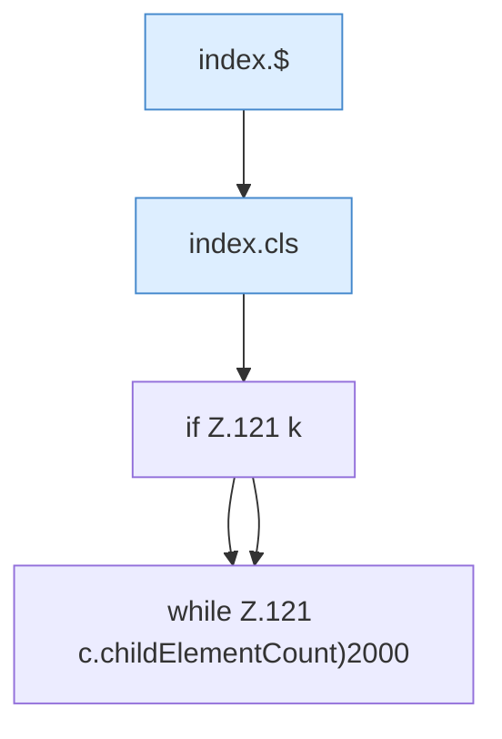

[[00 Start]] › [[Dashboard-UI]] › [[Legacy-Konsole]] › [[index.addLine]] › [[index.addLine.Teil1]]

# index.addLine.Teil1



```knoten
index.$
  `$` in `index.html`.
index.cls
  Leert die Konsole `cls`.
if Z.121 k
  Zeile 121: prüft `k`.
while Z.121 c.childElementCount)2000
  Zeile 121: Schleife `c.childElementCount)2000`.
```

- Fortsetzung von `index.addLine`, Quellreihenfolge.
