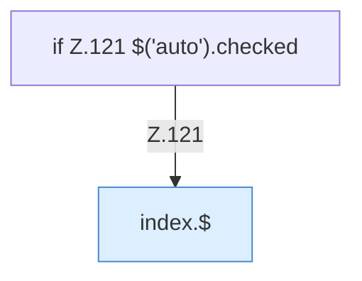

[[00 Start]] › [[Dashboard-UI]] › [[Legacy-Konsole]] › [[index.addLine]] › [[index.addLine.Teil2]]

# index.addLine.Teil2



```knoten
if Z.121 $('auto').checked
  Zeile 121: prüft `$('auto').checked`.
index.$
  `$` in `index.html`.
```

- Fortsetzung von `index.addLine`, Quellreihenfolge.
