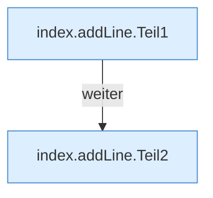

[[00 Start]] › [[Dashboard-UI]] › [[Legacy-Konsole]] › [[index.addLine]]

# index.addLine

`index.addLine(l)` [src/main/resources/web/index.html:121–121](https://github.com/Sciddie/minecraft-serverhoster-plugin/blob/95b02b953b0b4c23673e900e021a7c3c844aa37d/src/main/resources/web/index.html#L121-L121)

- `addLine` in `src/main/resources/web/index.html`
