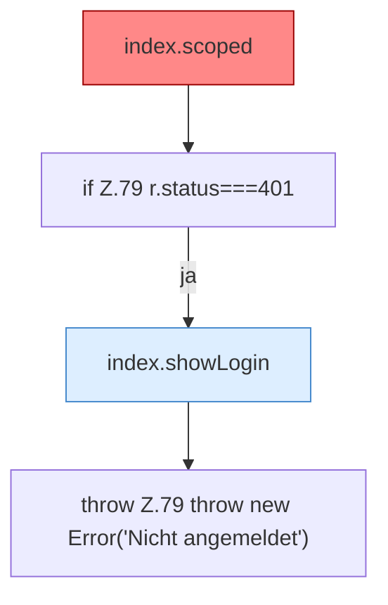

[[00 Start]] › [[Dashboard-UI]] › [[Legacy-Sitzung]] › [[index.api]] › [[index.api.Teil1]]

# index.api.Teil1



```knoten
index.scoped
  Gibt `path` unverändert zurück. Befund: Altlast (sicher).
if Z.79 r.status===401
  Zeile 79: prüft `r.status===401`.
index.showLogin
  Zeigt `showLogin`. Ruft `$`.
throw Z.79 throw new Error('Nicht angemeldet')
  Zeile 79: Abbruch `throw new Error('Nicht angemeldet')`.
```

- Fortsetzung von `index.api`, Quellreihenfolge.
