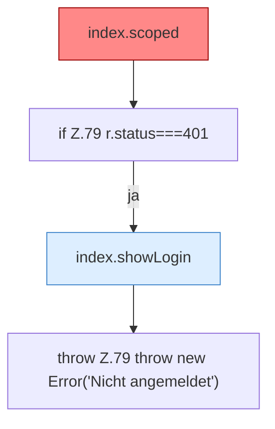

[[00 Start]] › [[Dashboard-UI]] › [[Legacy-Sitzung]] › [[index.api]] › [[index.api.Teil1]]

# index.api.Teil1



```knoten
index.scoped
  Gibt einen Dateipfad unverändert zurück. Der Name klingt nach einer Prüfung, es ist aber keine. Gibt `path` unverändert zurück. [[Glossar#Befund|Befund]]: [[Glossar#Altlast|Altlast]], sicher. index.html:77 return path
if Z.79 r.status===401
  Zeile 79: prüft `r.status===401`.
index.showLogin
  Die ältere [[Glossar#Bedienseite|Bedienseite]] zeigt die [[Glossar#Anmeldung|Anmeldung]]. Zeigt `showLogin`. Ruft `$`.
throw Z.79 throw new Error('Nicht angemeldet')
  Zeile 79: Abbruch `throw new Error('Nicht angemeldet')`.
```

> [!knoten]- Was die Blöcke tun
> - **index.scoped**: Gibt einen Dateipfad unverändert zurück. Der Name klingt nach einer Prüfung, es ist aber keine. Gibt `path` unverändert zurück. [[Glossar#Befund|Befund]]: [[Glossar#Altlast|Altlast]], sicher. index.html:77 return path
> - **if Z.79 r.status===401**: Zeile 79: prüft `r.status===401`.
> - **index.showLogin**: Die ältere [[Glossar#Bedienseite|Bedienseite]] zeigt die [[Glossar#Anmeldung|Anmeldung]]. Zeigt `showLogin`. Ruft `$`.
> - **throw Z.79 throw new Error('Nicht angemeldet')**: Zeile 79: Abbruch `throw new Error('Nicht angemeldet')`.

- Ein weiterer Abschnitt derselben Übersicht.
- Fortsetzung von `index.api`.
