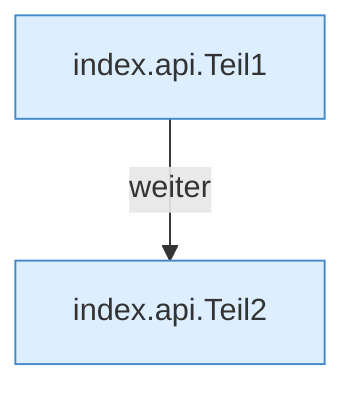

[[00 Start]] › [[Dashboard-UI]] › [[Legacy-Sitzung]] › [[index.api]]

# index.api

`index.api(path, opt={})` [src/main/resources/web/index.html:78–81](https://github.com/Sciddie/minecraft-serverhoster-plugin/blob/95b02b953b0b4c23673e900e021a7c3c844aa37d/src/main/resources/web/index.html#L78-L81)



```knoten
index.api.Teil1
  Ein weiterer Abschnitt derselben Übersicht. Im [[Glossar#Quelltext|Quelltext]] heißt das `Teil1`.
index.api.Teil2
  Ein weiterer Abschnitt derselben Übersicht. Im [[Glossar#Quelltext|Quelltext]] heißt das `Teil2`.
```

> [!knoten]- Was die Blöcke tun
> - **index.api.Teil1**: Ein weiterer Abschnitt derselben Übersicht. Im [[Glossar#Quelltext|Quelltext]] heißt das `Teil1`.
> - **index.api.Teil2**: Ein weiterer Abschnitt derselben Übersicht. Im [[Glossar#Quelltext|Quelltext]] heißt das `Teil2`.

- Schickt von der älteren [[Glossar#Bedienseite|Bedienseite]] eine Anfrage an die [[Glossar#Web-Schnittstelle|Web-Schnittstelle]].
