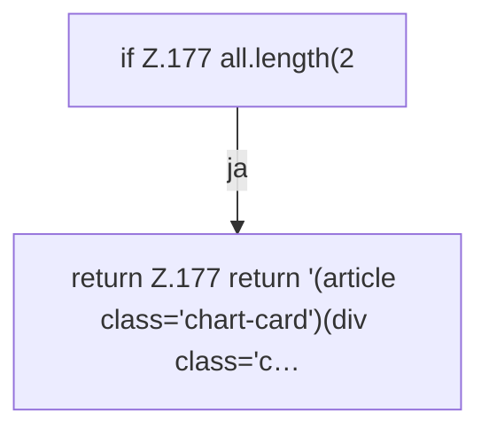

[[00 Start]] › [[Dashboard-UI]] › [[Legacy-Status]] › [[index.chartCard]] › [[index.chartCard.Teil1]]

# index.chartCard.Teil1



```knoten
if Z.177 all.length(2
  Zeile 177: prüft `all.length(2`.
return Z.177 return '(article class='chart-card')(div class='c…
  Zeile 177: Rückgabe `return '(article class='chart-card')(div class='c…`.
```

- Fortsetzung von `index.chartCard`, Quellreihenfolge.
