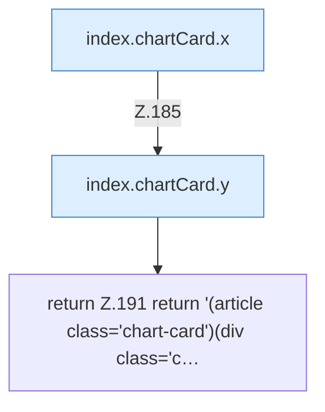

[[00 Start]] › [[Dashboard-UI]] › [[Legacy-Status]] › [[index.chartCard]] › [[index.chartCard.Teil2]]

# index.chartCard.Teil2



```knoten
index.chartCard.x
  Die ältere [[Glossar#Bedienseite|Bedienseite]] macht hier einen einzelnen Schritt. Eine Ebene tiefer steht er genauer. `x` in `index.html`.
index.chartCard.y
  Die ältere [[Glossar#Bedienseite|Bedienseite]] macht hier einen einzelnen Schritt. Eine Ebene tiefer steht er genauer. `y` in `index.html`.
return Z.191 return '(article class='chart-card')(div class='c…
  Zeile 191: Rückgabe `return '(article class='chart-card')(div class='c…`.
```

> [!knoten]- Was die Blöcke tun
> - **index.chartCard.x**: Die ältere [[Glossar#Bedienseite|Bedienseite]] macht hier einen einzelnen Schritt. Eine Ebene tiefer steht er genauer. `x` in `index.html`.
> - **index.chartCard.y**: Die ältere [[Glossar#Bedienseite|Bedienseite]] macht hier einen einzelnen Schritt. Eine Ebene tiefer steht er genauer. `y` in `index.html`.
> - **return Z.191 return '(article class='chart-card')(div class='c…**: Zeile 191: Rückgabe `return '(article class='chart-card')(div class='c…`.

- Ein weiterer Abschnitt derselben Übersicht.
- Fortsetzung von `index.chartCard`.
