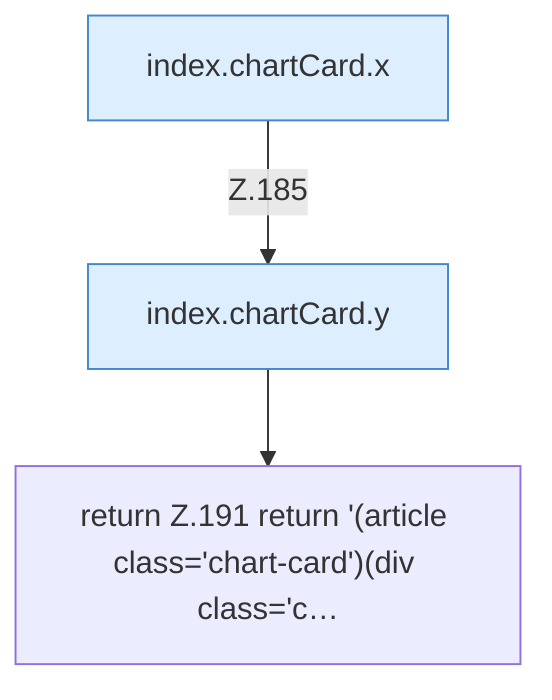

[[00 Start]] › [[Dashboard-UI]] › [[Legacy-Status]] › [[index.chartCard]] › [[index.chartCard.Teil2]]

# index.chartCard.Teil2



```knoten
index.chartCard.x
  `x` in `index.html`.
index.chartCard.y
  `y` in `index.html`.
return Z.191 return '(article class='chart-card')(div class='c…
  Zeile 191: Rückgabe `return '(article class='chart-card')(div class='c…`.
```

- Fortsetzung von `index.chartCard`, Quellreihenfolge.
