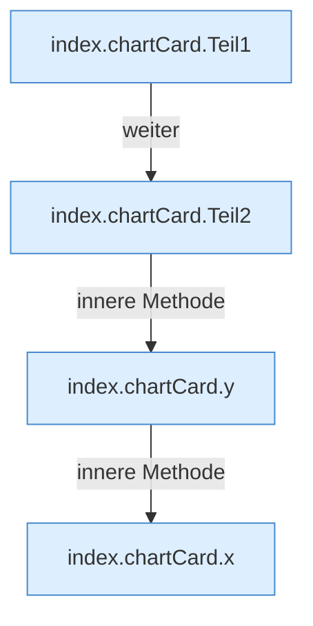

[[00 Start]] › [[Dashboard-UI]] › [[Legacy-Status]] › [[index.chartCard]]

# index.chartCard

`index.chartCard(title, caption, series, unit, limit)` [src/main/resources/web/index.html:173–192](https://github.com/Sciddie/minecraft-serverhoster-plugin/blob/95b02b953b0b4c23673e900e021a7c3c844aa37d/src/main/resources/web/index.html#L173-L192)



```knoten
index.chartCard.Teil1
  Ein weiterer Abschnitt derselben Übersicht. Im [[Glossar#Quelltext|Quelltext]] heißt das `Teil1`.
index.chartCard.Teil2
  Ein weiterer Abschnitt derselben Übersicht. Im [[Glossar#Quelltext|Quelltext]] heißt das `Teil2`.
index.chartCard.y
  Die ältere [[Glossar#Bedienseite|Bedienseite]] macht hier einen einzelnen Schritt. Eine Ebene tiefer steht er genauer. Im [[Glossar#Quelltext|Quelltext]] heißt das `y`.
index.chartCard.x
  Die ältere [[Glossar#Bedienseite|Bedienseite]] macht hier einen einzelnen Schritt. Eine Ebene tiefer steht er genauer. Im [[Glossar#Quelltext|Quelltext]] heißt das `x`.
```

> [!knoten]- Was die Blöcke tun
> - **index.chartCard.Teil1**: Ein weiterer Abschnitt derselben Übersicht. Im [[Glossar#Quelltext|Quelltext]] heißt das `Teil1`.
> - **index.chartCard.Teil2**: Ein weiterer Abschnitt derselben Übersicht. Im [[Glossar#Quelltext|Quelltext]] heißt das `Teil2`.
> - **index.chartCard.y**: Die ältere [[Glossar#Bedienseite|Bedienseite]] macht hier einen einzelnen Schritt. Eine Ebene tiefer steht er genauer. Im [[Glossar#Quelltext|Quelltext]] heißt das `y`.
> - **index.chartCard.x**: Die ältere [[Glossar#Bedienseite|Bedienseite]] macht hier einen einzelnen Schritt. Eine Ebene tiefer steht er genauer. Im [[Glossar#Quelltext|Quelltext]] heißt das `x`.

- Baut in der älteren [[Glossar#Bedienseite|Bedienseite]] eine Karte mit einer Kurve.
