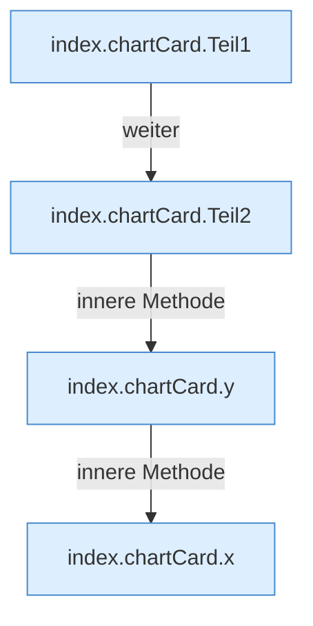

[[00 Start]] › [[Dashboard-UI]] › [[Legacy-Status]] › [[index.chartCard]]

# index.chartCard

`index.chartCard(title, caption, series, unit, limit)` [src/main/resources/web/index.html:173–192](https://github.com/Sciddie/minecraft-serverhoster-plugin/blob/95b02b953b0b4c23673e900e021a7c3c844aa37d/src/main/resources/web/index.html#L173-L192)



```knoten
index.chartCard.Teil1
  Abschnitt 1 dieses Ablaufs, in Quellreihenfolge.
index.chartCard.Teil2
  Abschnitt 2 dieses Ablaufs, in Quellreihenfolge.
index.chartCard.y
  `y` in `index.html`.
index.chartCard.x
  `x` in `index.html`.
```

- `chartCard` in `src/main/resources/web/index.html`
