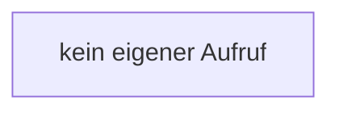

[[00 Start]] › [[Dashboard-UI]] › [[Legacy-Status]] › [[index.chartCard]] › [[index.chartCard.x]]

# index.chartCard.x

`index.x(i)` [src/main/resources/web/index.html:181–181](https://github.com/Sciddie/minecraft-serverhoster-plugin/blob/95b02b953b0b4c23673e900e021a7c3c844aa37d/src/main/resources/web/index.html#L181-L181)

- `x` in `src/main/resources/web/index.html`
