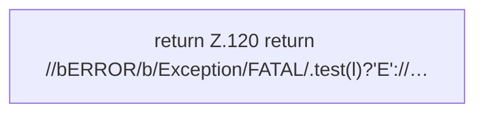

[[00 Start]] › [[Dashboard-UI]] › [[Legacy-Konsole]] › [[index.cls]]

# index.cls

`index.cls(l)` [src/main/resources/web/index.html:120–120](https://github.com/Sciddie/minecraft-serverhoster-plugin/blob/95b02b953b0b4c23673e900e021a7c3c844aa37d/src/main/resources/web/index.html#L120-L120)



```knoten
return Z.120 return //bERROR/b/Exception/FATAL/.test(l)?'E'://…
  Zeile 120: Rückgabe `return //bERROR/b/Exception/FATAL/.test(l)?'E'://…`.
```

- `cls` in `src/main/resources/web/index.html`
