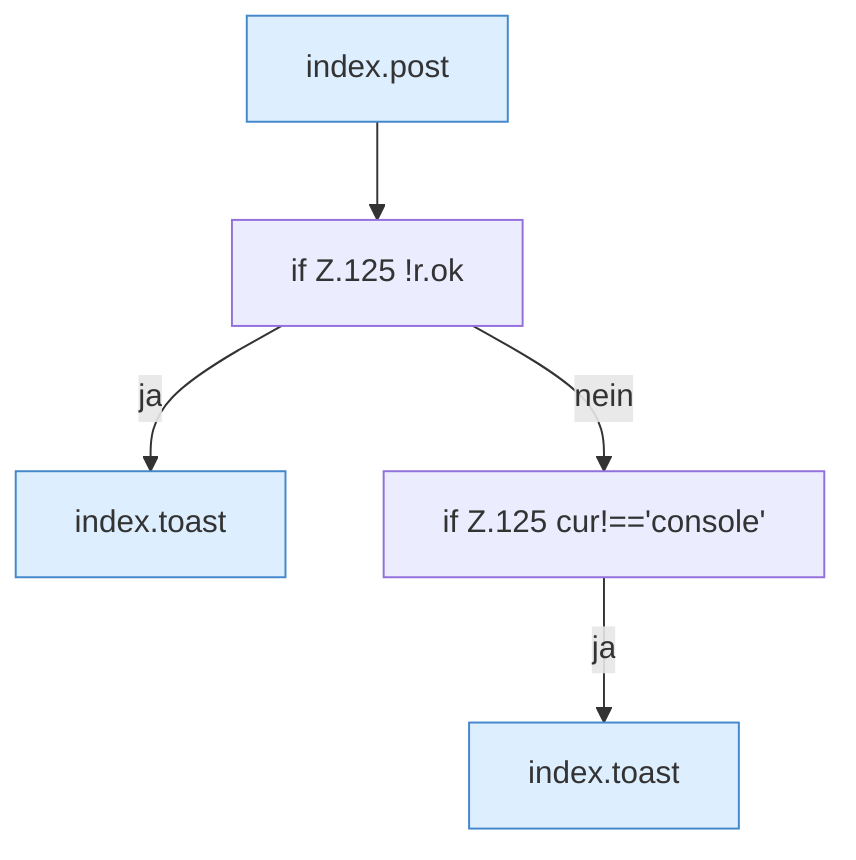

[[00 Start]] › [[Dashboard-UI]] › [[Legacy-Konsole]] › [[index.cmd]]

# index.cmd

`index.cmd(c)` [src/main/resources/web/index.html:125–125](https://github.com/Sciddie/minecraft-serverhoster-plugin/blob/95b02b953b0b4c23673e900e021a7c3c844aa37d/src/main/resources/web/index.html#L125-L125)

- `cmd` in `src/main/resources/web/index.html`
