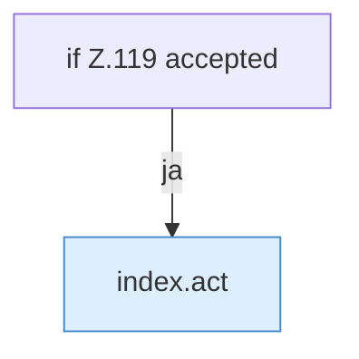

[[00 Start]] › [[Dashboard-UI]] › [[Legacy-Status]] › [[index.confirmStop]]

# index.confirmStop

`index.confirmStop()` [src/main/resources/web/index.html:119–119](https://github.com/Sciddie/minecraft-serverhoster-plugin/blob/95b02b953b0b4c23673e900e021a7c3c844aa37d/src/main/resources/web/index.html#L119-L119)



```knoten
if Z.119 accepted
  Hier fällt eine Entscheidung. Nur wenn sie zutrifft, geht es den Ja-Weg weiter. Das steht in [[Glossar#Zeile|Zeile]] 119.
index.act
  Schickt von der älteren [[Glossar#Bedienseite|Bedienseite]] Start, [[Glossar#Stopp|Stopp]] oder [[Glossar#Neustart|Neustart]]. Im [[Glossar#Quelltext|Quelltext]] heißt das `act`.
```

> [!knoten]- Was die Blöcke tun
> - **if Z.119 accepted**: Hier fällt eine Entscheidung. Nur wenn sie zutrifft, geht es den Ja-Weg weiter. Das steht in [[Glossar#Zeile|Zeile]] 119.
> - **index.act**: Schickt von der älteren [[Glossar#Bedienseite|Bedienseite]] Start, [[Glossar#Stopp|Stopp]] oder [[Glossar#Neustart|Neustart]]. Im [[Glossar#Quelltext|Quelltext]] heißt das `act`.

- Die ältere [[Glossar#Bedienseite|Bedienseite]] fragt nach den [[Glossar#Stopp|Stopp]].
