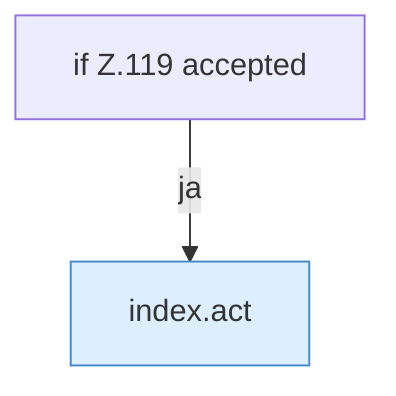

[[00 Start]] › [[Dashboard-UI]] › [[Legacy-Status]] › [[index.confirmStop]]

# index.confirmStop

`index.confirmStop()` [src/main/resources/web/index.html:119–119](https://github.com/Sciddie/minecraft-serverhoster-plugin/blob/95b02b953b0b4c23673e900e021a7c3c844aa37d/src/main/resources/web/index.html#L119-L119)



```knoten
if Z.119 accepted
  Zeile 119: prüft `accepted`.
index.act
  Sendet start, stop oder restart `act`. Ruft `$`, `post`, `toast`.
```

- `confirmStop` in `src/main/resources/web/index.html`
