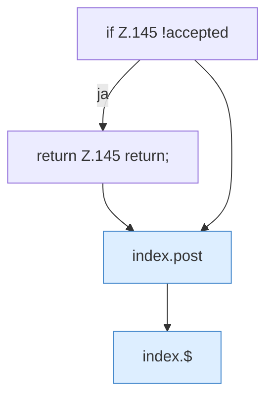

[[00 Start]] › [[Dashboard-UI]] › [[Legacy-Dateien]] › [[index.del]] › [[index.del.Teil1]]

# index.del.Teil1



```knoten
if Z.145 !accepted
  Zeile 145: prüft `!accepted`.
return Z.145 return;
  Zeile 145: Rückgabe `return;`.
index.post
  Sendet POST `post`. Ruft `api`.
index.$
  `$` in `index.html`.
```

- Fortsetzung von `index.del`, Quellreihenfolge.
