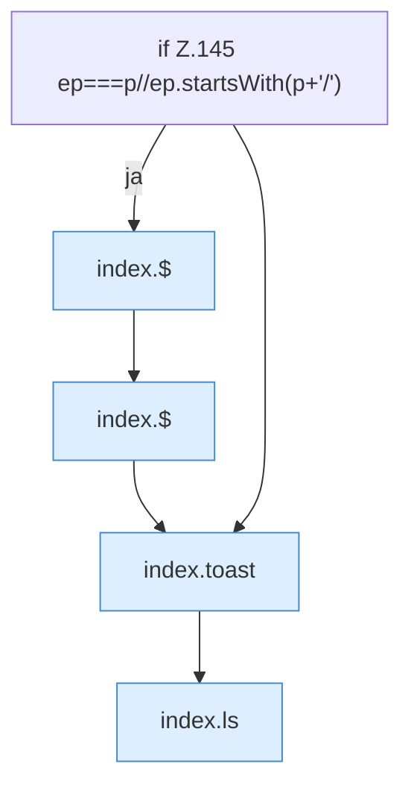

[[00 Start]] › [[Dashboard-UI]] › [[Legacy-Dateien]] › [[index.del]] › [[index.del.Teil2]]

# index.del.Teil2



```knoten
if Z.145 ep===p//ep.startsWith(p+'/')
  Zeile 145: prüft `ep===p//ep.startsWith(p+'/')`.
index.$
  Sucht auf der älteren [[Glossar#Bedienseite|Bedienseite]] ein einzelnes Element. `$` in `index.html`.
index.toast
  Zeigt in der älteren [[Glossar#Bedienseite|Bedienseite]] einen kurzen Hinweis. Zeigt eine Meldung `toast`. Ruft `$`.
index.ls
  Zeigt in der älteren [[Glossar#Bedienseite|Bedienseite]] den Inhalt eines Ordners. Listet das Verzeichnis `ls`. Ruft `api`, `esc`, `jp`.
```

> [!knoten]- Was die Blöcke tun
> - **if Z.145 ep===p//ep.startsWith(p+'/')**: Zeile 145: prüft `ep===p//ep.startsWith(p+'/')`.
> - **index.$**: Sucht auf der älteren [[Glossar#Bedienseite|Bedienseite]] ein einzelnes Element. `$` in `index.html`.
> - **index.toast**: Zeigt in der älteren [[Glossar#Bedienseite|Bedienseite]] einen kurzen Hinweis. Zeigt eine Meldung `toast`. Ruft `$`.
> - **index.ls**: Zeigt in der älteren [[Glossar#Bedienseite|Bedienseite]] den Inhalt eines Ordners. Listet das Verzeichnis `ls`. Ruft `api`, `esc`, `jp`.

- Ein weiterer Abschnitt derselben Übersicht.
- Fortsetzung von `index.del`.
