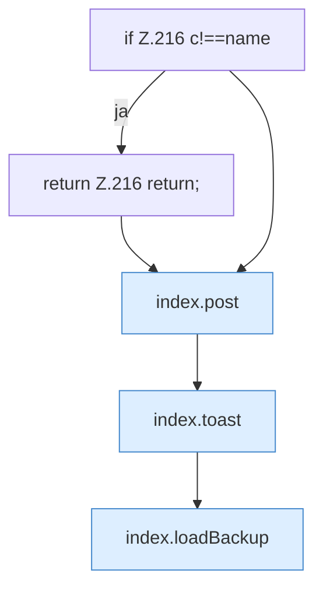

[[00 Start]] › [[Dashboard-UI]] › [[Legacy-Altlast]] › [[index.delBackup]]

# index.delBackup

`index.delBackup(name)` [src/main/resources/web/index.html:216–216](https://github.com/Sciddie/minecraft-serverhoster-plugin/blob/95b02b953b0b4c23673e900e021a7c3c844aa37d/src/main/resources/web/index.html#L216-L216)



```knoten
if Z.216 c!==name
  Zeile 216: prüft `c!==name`.
return Z.216 return;
  Zeile 216: Rückgabe `return;`.
index.post
  Sendet POST `post`. Ruft `api`.
index.toast
  Zeigt eine Meldung `toast`. Ruft `$`.
index.loadBackup
  Lädt `loadBackup`. Ruft `api`, `$`, `esc`.
```

- `delBackup` in `src/main/resources/web/index.html`
