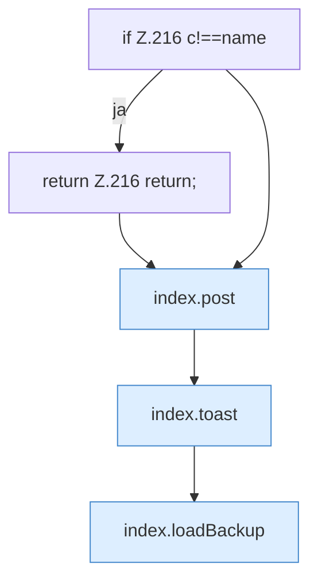

[[00 Start]] › [[Dashboard-UI]] › [[Legacy-Altlast]] › [[index.delBackup]]

# index.delBackup

`index.delBackup(name)` [src/main/resources/web/index.html:216–216](https://github.com/Sciddie/minecraft-serverhoster-plugin/blob/95b02b953b0b4c23673e900e021a7c3c844aa37d/src/main/resources/web/index.html#L216-L216)



```knoten
if Z.216 c!==name
  Hier fällt eine Entscheidung. Nur wenn sie zutrifft, geht es den Ja-Weg weiter. Das steht in [[Glossar#Zeile|Zeile]] 216.
return Z.216 return;
  Hier endet die [[Glossar#Funktion|Funktion]] und liefert ein Ergebnis zurück. Das steht in [[Glossar#Zeile|Zeile]] 216.
index.post
  Schickt von der älteren [[Glossar#Bedienseite|Bedienseite]] einen Auftrag, der etwas ändert. Im [[Glossar#Quelltext|Quelltext]] heißt das `post`.
index.toast
  Zeigt in der älteren [[Glossar#Bedienseite|Bedienseite]] einen kurzen Hinweis. Im [[Glossar#Quelltext|Quelltext]] heißt das `toast`.
index.loadBackup
  Die ältere [[Glossar#Bedienseite|Bedienseite]] lädt die [[Glossar#Sicherungskopie|Sicherungskopie]]. Im [[Glossar#Quelltext|Quelltext]] heißt das `loadBackup`.
```

> [!knoten]- Was die Blöcke tun
> - **if Z.216 c!==name**: Hier fällt eine Entscheidung. Nur wenn sie zutrifft, geht es den Ja-Weg weiter. Das steht in [[Glossar#Zeile|Zeile]] 216.
> - **return Z.216 return;**: Hier endet die [[Glossar#Funktion|Funktion]] und liefert ein Ergebnis zurück. Das steht in [[Glossar#Zeile|Zeile]] 216.
> - **index.post**: Schickt von der älteren [[Glossar#Bedienseite|Bedienseite]] einen Auftrag, der etwas ändert. Im [[Glossar#Quelltext|Quelltext]] heißt das `post`.
> - **index.toast**: Zeigt in der älteren [[Glossar#Bedienseite|Bedienseite]] einen kurzen Hinweis. Im [[Glossar#Quelltext|Quelltext]] heißt das `toast`.
> - **index.loadBackup**: Die ältere [[Glossar#Bedienseite|Bedienseite]] lädt die [[Glossar#Sicherungskopie|Sicherungskopie]]. Im [[Glossar#Quelltext|Quelltext]] heißt das `loadBackup`.

- Die ältere [[Glossar#Bedienseite|Bedienseite]] löscht die [[Glossar#Sicherungskopie|Sicherungskopie]].
