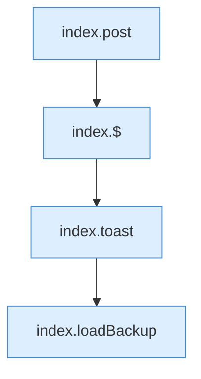

[[00 Start]] › [[Dashboard-UI]] › [[Legacy-Altlast]] › [[index.doBackup]]

# index.doBackup

`index.doBackup()` [src/main/resources/web/index.html:218–218](https://github.com/Sciddie/minecraft-serverhoster-plugin/blob/95b02b953b0b4c23673e900e021a7c3c844aa37d/src/main/resources/web/index.html#L218-L218)



```knoten
index.post
  Schickt von der älteren [[Glossar#Bedienseite|Bedienseite]] einen Auftrag, der etwas ändert. Im [[Glossar#Quelltext|Quelltext]] heißt das `post`.
index.$
  Sucht auf der älteren [[Glossar#Bedienseite|Bedienseite]] ein einzelnes Element. Im [[Glossar#Quelltext|Quelltext]] heißt das `$`.
index.toast
  Zeigt in der älteren [[Glossar#Bedienseite|Bedienseite]] einen kurzen Hinweis. Im [[Glossar#Quelltext|Quelltext]] heißt das `toast`.
index.loadBackup
  Die ältere [[Glossar#Bedienseite|Bedienseite]] lädt die [[Glossar#Sicherungskopie|Sicherungskopie]]. Im [[Glossar#Quelltext|Quelltext]] heißt das `loadBackup`.
```

> [!knoten]- Was die Blöcke tun
> - **index.post**: Schickt von der älteren [[Glossar#Bedienseite|Bedienseite]] einen Auftrag, der etwas ändert. Im [[Glossar#Quelltext|Quelltext]] heißt das `post`.
> - **index.$**: Sucht auf der älteren [[Glossar#Bedienseite|Bedienseite]] ein einzelnes Element. Im [[Glossar#Quelltext|Quelltext]] heißt das `$`.
> - **index.toast**: Zeigt in der älteren [[Glossar#Bedienseite|Bedienseite]] einen kurzen Hinweis. Im [[Glossar#Quelltext|Quelltext]] heißt das `toast`.
> - **index.loadBackup**: Die ältere [[Glossar#Bedienseite|Bedienseite]] lädt die [[Glossar#Sicherungskopie|Sicherungskopie]]. Im [[Glossar#Quelltext|Quelltext]] heißt das `loadBackup`.

- Die ältere [[Glossar#Bedienseite|Bedienseite]] führt aus die [[Glossar#Sicherungskopie|Sicherungskopie]].
