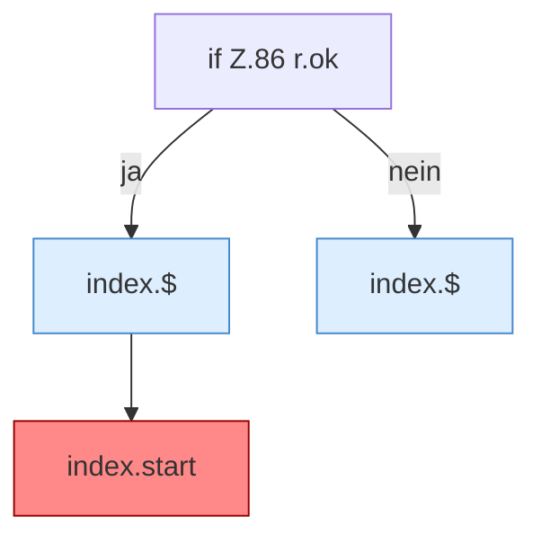

[[00 Start]] › [[Dashboard-UI]] › [[Legacy-Sitzung]] › [[index.doLogin]] › [[index.doLogin.Z86]]

# index.doLogin.Z86



```knoten
if Z.86 r.ok
  Zeile 86: prüft `r.ok`.
index.$
  Sucht auf der älteren [[Glossar#Bedienseite|Bedienseite]] ein einzelnes Element. `$` in `index.html`.
index.start
  Die ältere [[Glossar#Bedienseite|Bedienseite]] fragt ab jetzt alle drei Sekunden nach dem Zustand. Browser-Timer 3000 ms für `status`. [[Glossar#Befund|Befund]]: doppelte Implementierung, sicher. index.html:220 setInterval 3000 ms läuft in der React-Hülle weiter
```

> [!knoten]- Was die Blöcke tun
> - **if Z.86 r.ok**: Zeile 86: prüft `r.ok`.
> - **index.$**: Sucht auf der älteren [[Glossar#Bedienseite|Bedienseite]] ein einzelnes Element. `$` in `index.html`.
> - **index.start**: Die ältere [[Glossar#Bedienseite|Bedienseite]] fragt ab jetzt alle drei Sekunden nach dem Zustand. Browser-Timer 3000 ms für `status`. [[Glossar#Befund|Befund]]: doppelte Implementierung, sicher. index.html:220 setInterval 3000 ms läuft in der React-Hülle weiter

- Der Ablauf geht in [[Glossar#Zeile|Zeile]] 86 weiter. Eine Ebene tiefer steht er genauer.
- Fortsetzung von `index.doLogin`.
