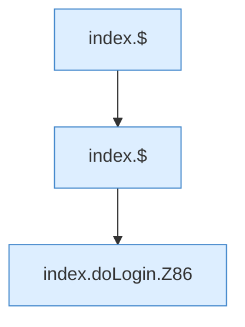

[[00 Start]] › [[Dashboard-UI]] › [[Legacy-Sitzung]] › [[index.doLogin]]

# index.doLogin

`index.doLogin()` [src/main/resources/web/index.html:85–86](https://github.com/Sciddie/minecraft-serverhoster-plugin/blob/95b02b953b0b4c23673e900e021a7c3c844aa37d/src/main/resources/web/index.html#L85-L86)



```knoten
index.$
  `$` in `index.html`.
index.doLogin.Z86
  Fortsetzung des Ablaufs ab Zeile 86.
```

- `doLogin` in `src/main/resources/web/index.html`
