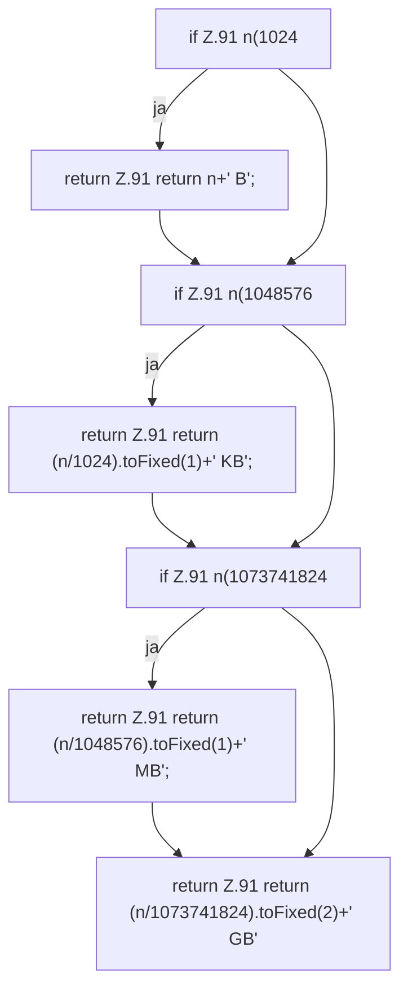

[[00 Start]] › [[Dashboard-UI]] › [[Legacy-Status]] › [[index.fmtSize]]

# index.fmtSize

`index.fmtSize(n)` [src/main/resources/web/index.html:91–91](https://github.com/Sciddie/minecraft-serverhoster-plugin/blob/95b02b953b0b4c23673e900e021a7c3c844aa37d/src/main/resources/web/index.html#L91-L91)



```knoten
if Z.91 n(1024
  Hier fällt eine Entscheidung. Nur wenn sie zutrifft, geht es den Ja-Weg weiter. Das steht in [[Glossar#Zeile|Zeile]] 91.
return Z.91 return n+' B';
  Hier endet die [[Glossar#Funktion|Funktion]] und liefert ein Ergebnis zurück. Das steht in [[Glossar#Zeile|Zeile]] 91.
if Z.91 n(1048576
  Hier fällt eine Entscheidung. Nur wenn sie zutrifft, geht es den Ja-Weg weiter. Das steht in [[Glossar#Zeile|Zeile]] 91.
return Z.91 return (n/1024).toFixed(1)+' KB';
  Hier endet die [[Glossar#Funktion|Funktion]] und liefert ein Ergebnis zurück. Das steht in [[Glossar#Zeile|Zeile]] 91.
if Z.91 n(1073741824
  Hier fällt eine Entscheidung. Nur wenn sie zutrifft, geht es den Ja-Weg weiter. Das steht in [[Glossar#Zeile|Zeile]] 91.
return Z.91 return (n/1048576).toFixed(1)+' MB';
  Hier endet die [[Glossar#Funktion|Funktion]] und liefert ein Ergebnis zurück. Das steht in [[Glossar#Zeile|Zeile]] 91.
return Z.91 return (n/1073741824).toFixed(2)+' GB'
  Hier endet die [[Glossar#Funktion|Funktion]] und liefert ein Ergebnis zurück. Das steht in [[Glossar#Zeile|Zeile]] 91.
```

> [!knoten]- Was die Blöcke tun
> - **if Z.91 n(1024**: Hier fällt eine Entscheidung. Nur wenn sie zutrifft, geht es den Ja-Weg weiter. Das steht in [[Glossar#Zeile|Zeile]] 91.
> - **return Z.91 return n+' B';**: Hier endet die [[Glossar#Funktion|Funktion]] und liefert ein Ergebnis zurück. Das steht in [[Glossar#Zeile|Zeile]] 91.
> - **if Z.91 n(1048576**: Hier fällt eine Entscheidung. Nur wenn sie zutrifft, geht es den Ja-Weg weiter. Das steht in [[Glossar#Zeile|Zeile]] 91.
> - **return Z.91 return (n/1024).toFixed(1)+' KB';**: Hier endet die [[Glossar#Funktion|Funktion]] und liefert ein Ergebnis zurück. Das steht in [[Glossar#Zeile|Zeile]] 91.
> - **if Z.91 n(1073741824**: Hier fällt eine Entscheidung. Nur wenn sie zutrifft, geht es den Ja-Weg weiter. Das steht in [[Glossar#Zeile|Zeile]] 91.
> - **return Z.91 return (n/1048576).toFixed(1)+' MB';**: Hier endet die [[Glossar#Funktion|Funktion]] und liefert ein Ergebnis zurück. Das steht in [[Glossar#Zeile|Zeile]] 91.
> - **return Z.91 return (n/1073741824).toFixed(2)+' GB'**: Hier endet die [[Glossar#Funktion|Funktion]] und liefert ein Ergebnis zurück. Das steht in [[Glossar#Zeile|Zeile]] 91.

- Die ältere [[Glossar#Bedienseite|Bedienseite]] macht lesbar die Größe.
