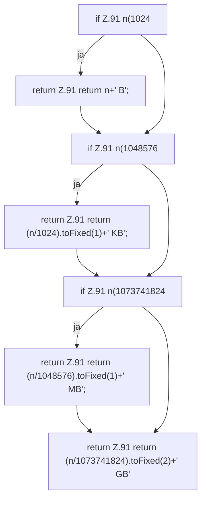

[[00 Start]] › [[Dashboard-UI]] › [[Legacy-Status]] › [[index.fmtSize]]

# index.fmtSize

`index.fmtSize(n)` [src/main/resources/web/index.html:91–91](https://github.com/Sciddie/minecraft-serverhoster-plugin/blob/95b02b953b0b4c23673e900e021a7c3c844aa37d/src/main/resources/web/index.html#L91-L91)



```knoten
if Z.91 n(1024
  Zeile 91: prüft `n(1024`.
return Z.91 return n+' B';
  Zeile 91: Rückgabe `return n+' B';`.
if Z.91 n(1048576
  Zeile 91: prüft `n(1048576`.
return Z.91 return (n/1024).toFixed(1)+' KB';
  Zeile 91: Rückgabe `return (n/1024).toFixed(1)+' KB';`.
if Z.91 n(1073741824
  Zeile 91: prüft `n(1073741824`.
return Z.91 return (n/1048576).toFixed(1)+' MB';
  Zeile 91: Rückgabe `return (n/1048576).toFixed(1)+' MB';`.
return Z.91 return (n/1073741824).toFixed(2)+' GB'
  Zeile 91: Rückgabe `return (n/1073741824).toFixed(2)+' GB'`.
```

- `fmtSize` in `src/main/resources/web/index.html`
