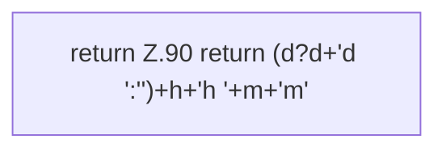

[[00 Start]] › [[Dashboard-UI]] › [[Legacy-Status]] › [[index.fmtUp]]

# index.fmtUp

`index.fmtUp(s)` [src/main/resources/web/index.html:90–90](https://github.com/Sciddie/minecraft-serverhoster-plugin/blob/95b02b953b0b4c23673e900e021a7c3c844aa37d/src/main/resources/web/index.html#L90-L90)



```knoten
return Z.90 return (d?d+'d ':'')+h+'h '+m+'m'
  Zeile 90: Rückgabe `return (d?d+'d ':'')+h+'h '+m+'m'`.
```

- `fmtUp` in `src/main/resources/web/index.html`
