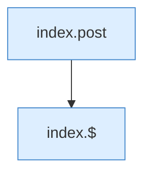

[[00 Start]] › [[Dashboard-UI]] › [[Legacy-Diag]] › [[index.jcmd]]

# index.jcmd

`index.jcmd(k)` [src/main/resources/web/index.html:207–207](https://github.com/Sciddie/minecraft-serverhoster-plugin/blob/95b02b953b0b4c23673e900e021a7c3c844aa37d/src/main/resources/web/index.html#L207-L207)



```knoten
index.post
  Schickt von der älteren [[Glossar#Bedienseite|Bedienseite]] einen Auftrag, der etwas ändert. Im [[Glossar#Quelltext|Quelltext]] heißt das `post`.
index.$
  Sucht auf der älteren [[Glossar#Bedienseite|Bedienseite]] ein einzelnes Element. Im [[Glossar#Quelltext|Quelltext]] heißt das `$`.
```

> [!knoten]- Was die Blöcke tun
> - **index.post**: Schickt von der älteren [[Glossar#Bedienseite|Bedienseite]] einen Auftrag, der etwas ändert. Im [[Glossar#Quelltext|Quelltext]] heißt das `post`.
> - **index.$**: Sucht auf der älteren [[Glossar#Bedienseite|Bedienseite]] ein einzelnes Element. Im [[Glossar#Quelltext|Quelltext]] heißt das `$`.

- Die ältere [[Glossar#Bedienseite|Bedienseite]] macht hier einen einzelnen Schritt. Eine Ebene tiefer steht er genauer.
