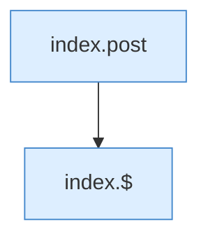

[[00 Start]] › [[Dashboard-UI]] › [[Legacy-Diag]] › [[index.jcmd]]

# index.jcmd

`index.jcmd(k)` [src/main/resources/web/index.html:207–207](https://github.com/Sciddie/minecraft-serverhoster-plugin/blob/95b02b953b0b4c23673e900e021a7c3c844aa37d/src/main/resources/web/index.html#L207-L207)



```knoten
index.post
  Sendet POST `post`. Ruft `api`.
index.$
  `$` in `index.html`.
```

- `jcmd` in `src/main/resources/web/index.html`
