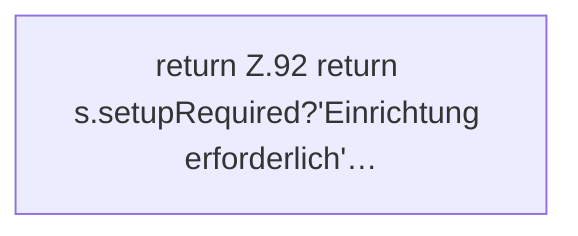

[[00 Start]] › [[Dashboard-UI]] › [[Legacy-Status]] › [[index.lifecycleLabel]]

# index.lifecycleLabel

`index.lifecycleLabel(s)` [src/main/resources/web/index.html:92–92](https://github.com/Sciddie/minecraft-serverhoster-plugin/blob/95b02b953b0b4c23673e900e021a7c3c844aa37d/src/main/resources/web/index.html#L92-L92)



```knoten
return Z.92 return s.setupRequired?'Einrichtung erforderlich'…
  Hier endet die [[Glossar#Funktion|Funktion]] und liefert ein Ergebnis zurück. Das steht in [[Glossar#Zeile|Zeile]] 92.
```

> [!knoten]- Was die Blöcke tun
> - **return Z.92 return s.setupRequired?'Einrichtung erforderlich'…**: Hier endet die [[Glossar#Funktion|Funktion]] und liefert ein Ergebnis zurück. Das steht in [[Glossar#Zeile|Zeile]] 92.

- Setzt die Beschriftung, die den Zustand in der älteren [[Glossar#Bedienseite|Bedienseite]] zeigt.
