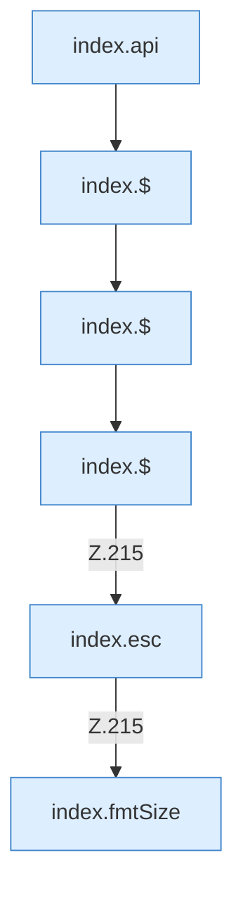

[[00 Start]] › [[Dashboard-UI]] › [[Legacy-Altlast]] › [[index.loadBackup]]

# index.loadBackup

`index.loadBackup()` [src/main/resources/web/index.html:214–215](https://github.com/Sciddie/minecraft-serverhoster-plugin/blob/95b02b953b0b4c23673e900e021a7c3c844aa37d/src/main/resources/web/index.html#L214-L215)



```knoten
index.api
  Sendet einen Dashboard-Request `api`. Ruft `scoped`, `showLogin`, `toast`.
index.$
  `$` in `index.html`.
index.esc
  Maskiert HTML `esc`.
index.fmtSize
  Formatiert `fmtSize`.
```

- `loadBackup` in `src/main/resources/web/index.html`
