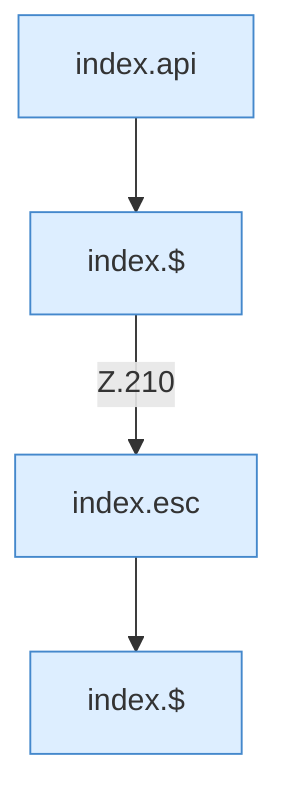

[[00 Start]] › [[Dashboard-UI]] › [[Legacy-Diag]] › [[index.loadCrashes]]

# index.loadCrashes

`index.loadCrashes()` [src/main/resources/web/index.html:210–210](https://github.com/Sciddie/minecraft-serverhoster-plugin/blob/95b02b953b0b4c23673e900e021a7c3c844aa37d/src/main/resources/web/index.html#L210-L210)



```knoten
index.api
  Sendet einen Dashboard-Request `api`. Ruft `scoped`, `showLogin`, `toast`.
index.$
  `$` in `index.html`.
index.esc
  Maskiert HTML `esc`.
```

- `loadCrashes` in `src/main/resources/web/index.html`
