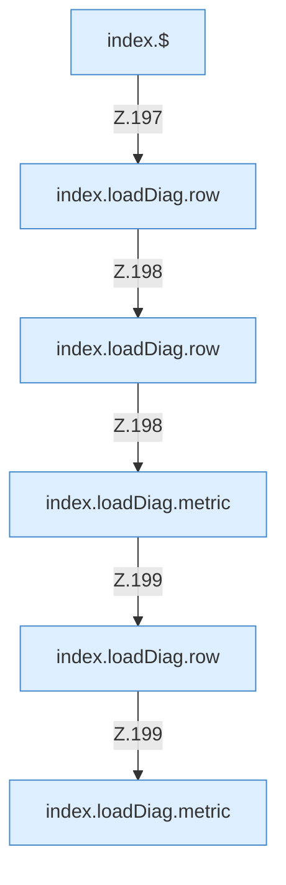

[[00 Start]] › [[Dashboard-UI]] › [[Legacy-Diag]] › [[index.loadDiag]] › [[index.loadDiag.Calls196]]

# index.loadDiag.Calls196



```knoten
index.$
  Sucht auf der älteren [[Glossar#Bedienseite|Bedienseite]] ein einzelnes Element. `$` in `index.html`.
index.loadDiag.row
  Die ältere [[Glossar#Bedienseite|Bedienseite]] macht hier einen einzelnen Schritt. Eine Ebene tiefer steht er genauer. Baut eine Tabellenzeile `row`. Ruft `esc`.
index.loadDiag.metric
  Die ältere [[Glossar#Bedienseite|Bedienseite]] macht hier einen einzelnen Schritt. Eine Ebene tiefer steht er genauer. Formatiert einen Messwert `metric`.
```

> [!knoten]- Was die Blöcke tun
> - **index.$**: Sucht auf der älteren [[Glossar#Bedienseite|Bedienseite]] ein einzelnes Element. `$` in `index.html`.
> - **index.loadDiag.row**: Die ältere [[Glossar#Bedienseite|Bedienseite]] macht hier einen einzelnen Schritt. Eine Ebene tiefer steht er genauer. Baut eine Tabellenzeile `row`. Ruft `esc`.
> - **index.loadDiag.metric**: Die ältere [[Glossar#Bedienseite|Bedienseite]] macht hier einen einzelnen Schritt. Eine Ebene tiefer steht er genauer. Formatiert einen Messwert `metric`.

- Weitere [[Glossar#Funktion|Funktionen]], die ab [[Glossar#Zeile|Zeile]] 196 aufgerufen werden.
- Fortsetzung von `index.loadDiag`.
