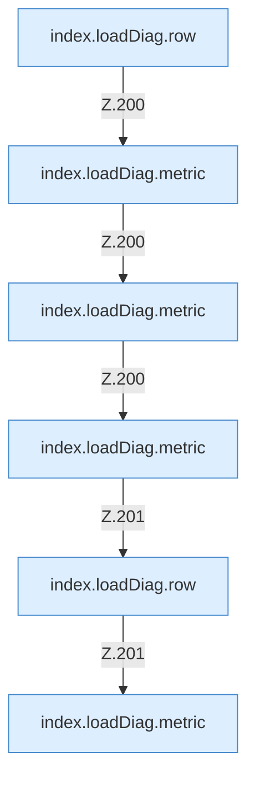

[[00 Start]] › [[Dashboard-UI]] › [[Legacy-Diag]] › [[index.loadDiag]] › [[index.loadDiag.Calls200]]

# index.loadDiag.Calls200



```knoten
index.loadDiag.row
  Baut eine Tabellenzeile `row`. Ruft `esc`.
index.loadDiag.metric
  Formatiert einen Messwert `metric`.
```

- Fortsetzung von `index.loadDiag`, Quellreihenfolge.
