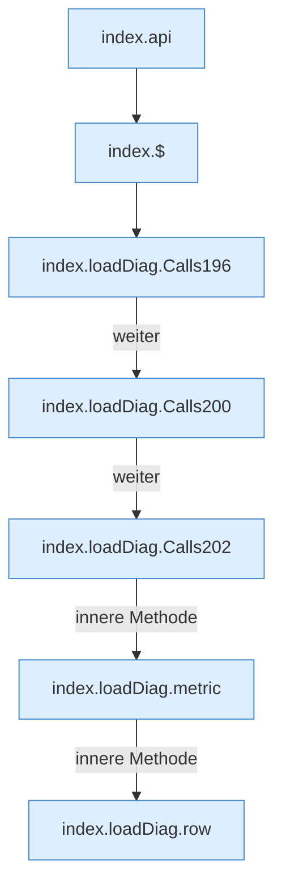

[[00 Start]] › [[Dashboard-UI]] › [[Legacy-Diag]] › [[index.loadDiag]]

# index.loadDiag

`index.loadDiag()` [src/main/resources/web/index.html:193–206](https://github.com/Sciddie/minecraft-serverhoster-plugin/blob/95b02b953b0b4c23673e900e021a7c3c844aa37d/src/main/resources/web/index.html#L193-L206)



```knoten
index.api
  Sendet einen Dashboard-Request `api`. Ruft `scoped`, `showLogin`, `toast`.
index.$
  `$` in `index.html`.
index.loadDiag.Calls196
  Weitere eigene Aufrufe ab Zeile 196.
index.loadDiag.Calls200
  Weitere eigene Aufrufe ab Zeile 200.
index.loadDiag.Calls202
  Weitere eigene Aufrufe ab Zeile 202.
index.loadDiag.metric
  Formatiert einen Messwert `metric`.
index.loadDiag.row
  Baut eine Tabellenzeile `row`. Ruft `esc`.
```

- `loadDiag` in `src/main/resources/web/index.html`
