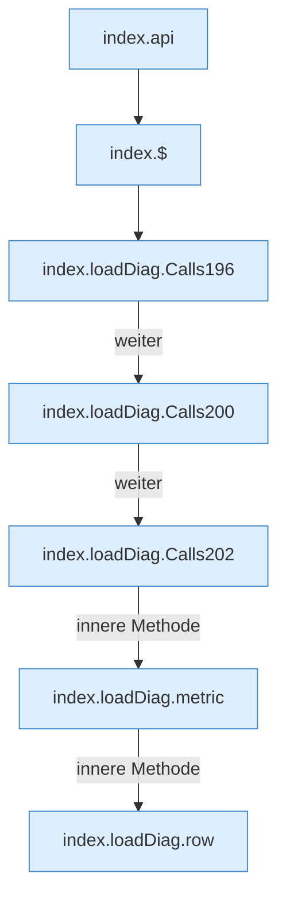

[[00 Start]] › [[Dashboard-UI]] › [[Legacy-Diag]] › [[index.loadDiag]]

# index.loadDiag

`index.loadDiag()` [src/main/resources/web/index.html:193–206](https://github.com/Sciddie/minecraft-serverhoster-plugin/blob/95b02b953b0b4c23673e900e021a7c3c844aa37d/src/main/resources/web/index.html#L193-L206)



```knoten
index.api
  Schickt von der älteren [[Glossar#Bedienseite|Bedienseite]] eine Anfrage an die [[Glossar#Web-Schnittstelle|Web-Schnittstelle]]. Im [[Glossar#Quelltext|Quelltext]] heißt das `api`.
index.$
  Sucht auf der älteren [[Glossar#Bedienseite|Bedienseite]] ein einzelnes Element. Im [[Glossar#Quelltext|Quelltext]] heißt das `$`.
index.loadDiag.Calls196
  Weitere [[Glossar#Funktion|Funktionen]], die ab [[Glossar#Zeile|Zeile]] 196 aufgerufen werden. Im [[Glossar#Quelltext|Quelltext]] heißt das `Calls196`.
index.loadDiag.Calls200
  Weitere [[Glossar#Funktion|Funktionen]], die ab [[Glossar#Zeile|Zeile]] 200 aufgerufen werden. Im [[Glossar#Quelltext|Quelltext]] heißt das `Calls200`.
index.loadDiag.Calls202
  Weitere [[Glossar#Funktion|Funktionen]], die ab [[Glossar#Zeile|Zeile]] 202 aufgerufen werden. Im [[Glossar#Quelltext|Quelltext]] heißt das `Calls202`.
index.loadDiag.metric
  Die ältere [[Glossar#Bedienseite|Bedienseite]] macht hier einen einzelnen Schritt. Eine Ebene tiefer steht er genauer. Im [[Glossar#Quelltext|Quelltext]] heißt das `metric`.
index.loadDiag.row
  Die ältere [[Glossar#Bedienseite|Bedienseite]] macht hier einen einzelnen Schritt. Eine Ebene tiefer steht er genauer. Im [[Glossar#Quelltext|Quelltext]] heißt das `row`.
```

> [!knoten]- Was die Blöcke tun
> - **index.api**: Schickt von der älteren [[Glossar#Bedienseite|Bedienseite]] eine Anfrage an die [[Glossar#Web-Schnittstelle|Web-Schnittstelle]]. Im [[Glossar#Quelltext|Quelltext]] heißt das `api`.
> - **index.$**: Sucht auf der älteren [[Glossar#Bedienseite|Bedienseite]] ein einzelnes Element. Im [[Glossar#Quelltext|Quelltext]] heißt das `$`.
> - **index.loadDiag.Calls196**: Weitere [[Glossar#Funktion|Funktionen]], die ab [[Glossar#Zeile|Zeile]] 196 aufgerufen werden. Im [[Glossar#Quelltext|Quelltext]] heißt das `Calls196`.
> - **index.loadDiag.Calls200**: Weitere [[Glossar#Funktion|Funktionen]], die ab [[Glossar#Zeile|Zeile]] 200 aufgerufen werden. Im [[Glossar#Quelltext|Quelltext]] heißt das `Calls200`.
> - **index.loadDiag.Calls202**: Weitere [[Glossar#Funktion|Funktionen]], die ab [[Glossar#Zeile|Zeile]] 202 aufgerufen werden. Im [[Glossar#Quelltext|Quelltext]] heißt das `Calls202`.
> - **index.loadDiag.metric**: Die ältere [[Glossar#Bedienseite|Bedienseite]] macht hier einen einzelnen Schritt. Eine Ebene tiefer steht er genauer. Im [[Glossar#Quelltext|Quelltext]] heißt das `metric`.
> - **index.loadDiag.row**: Die ältere [[Glossar#Bedienseite|Bedienseite]] macht hier einen einzelnen Schritt. Eine Ebene tiefer steht er genauer. Im [[Glossar#Quelltext|Quelltext]] heißt das `row`.

- Die ältere [[Glossar#Bedienseite|Bedienseite]] lädt die [[Glossar#Diagnose|Diagnose]].
