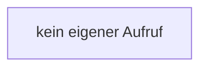

[[00 Start]] › [[Dashboard-UI]] › [[Legacy-Diag]] › [[index.loadDiag]] › [[index.loadDiag.metric]]

# index.loadDiag.metric

`index.metric(v, unit='')` [src/main/resources/web/index.html:194–194](https://github.com/Sciddie/minecraft-serverhoster-plugin/blob/95b02b953b0b4c23673e900e021a7c3c844aa37d/src/main/resources/web/index.html#L194-L194)



```knoten
kein eigener Aufruf
  In diesem Stück gibt es keinen weiteren eigenen Aufruf.
```

- `metric` in `src/main/resources/web/index.html`
