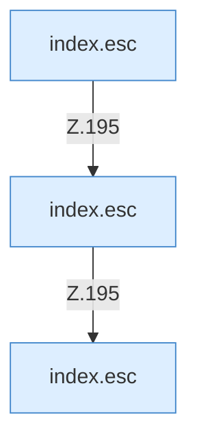

[[00 Start]] › [[Dashboard-UI]] › [[Legacy-Diag]] › [[index.loadDiag]] › [[index.loadDiag.row]]

# index.loadDiag.row

`index.row(title, value, help)` [src/main/resources/web/index.html:195–195](https://github.com/Sciddie/minecraft-serverhoster-plugin/blob/95b02b953b0b4c23673e900e021a7c3c844aa37d/src/main/resources/web/index.html#L195-L195)



```knoten
index.esc
  Macht einen Text so ungefährlich, dass die Seite ihn anzeigen kann. Maskiert HTML `esc`.
```

> [!knoten]- Was die Blöcke tun
> - **index.esc**: Macht einen Text so ungefährlich, dass die Seite ihn anzeigen kann. Maskiert HTML `esc`.

- Die ältere [[Glossar#Bedienseite|Bedienseite]] macht hier einen einzelnen Schritt. Eine Ebene tiefer steht er genauer.
- `row` in `src/main/resources/web/index.html`
