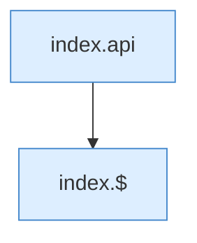

[[00 Start]] › [[Dashboard-UI]] › [[Legacy-Diag]] › [[index.loadJar]]

# index.loadJar

`index.loadJar()` [src/main/resources/web/index.html:209–209](https://github.com/Sciddie/minecraft-serverhoster-plugin/blob/95b02b953b0b4c23673e900e021a7c3c844aa37d/src/main/resources/web/index.html#L209-L209)

- `loadJar` in `src/main/resources/web/index.html`
