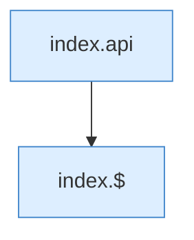

[[00 Start]] › [[Dashboard-UI]] › [[Legacy-Diag]] › [[index.loadJar]]

# index.loadJar

`index.loadJar()` [src/main/resources/web/index.html:209–209](https://github.com/Sciddie/minecraft-serverhoster-plugin/blob/95b02b953b0b4c23673e900e021a7c3c844aa37d/src/main/resources/web/index.html#L209-L209)



```knoten
index.api
  Schickt von der älteren [[Glossar#Bedienseite|Bedienseite]] eine Anfrage an die [[Glossar#Web-Schnittstelle|Web-Schnittstelle]]. Im [[Glossar#Quelltext|Quelltext]] heißt das `api`.
index.$
  Sucht auf der älteren [[Glossar#Bedienseite|Bedienseite]] ein einzelnes Element. Im [[Glossar#Quelltext|Quelltext]] heißt das `$`.
```

> [!knoten]- Was die Blöcke tun
> - **index.api**: Schickt von der älteren [[Glossar#Bedienseite|Bedienseite]] eine Anfrage an die [[Glossar#Web-Schnittstelle|Web-Schnittstelle]]. Im [[Glossar#Quelltext|Quelltext]] heißt das `api`.
> - **index.$**: Sucht auf der älteren [[Glossar#Bedienseite|Bedienseite]] ein einzelnes Element. Im [[Glossar#Quelltext|Quelltext]] heißt das `$`.

- Die ältere [[Glossar#Bedienseite|Bedienseite]] lädt die [[Glossar#Programmdatei|Programmdatei]].
