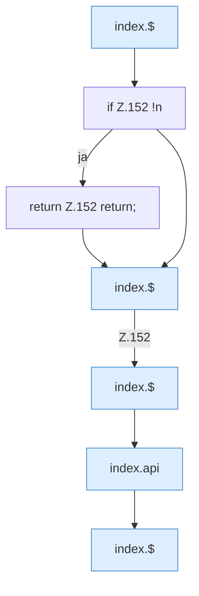

[[00 Start]] › [[Dashboard-UI]] › [[Legacy-Logs]] › [[index.loadLog]] › [[index.loadLog.Teil1]]

# index.loadLog.Teil1



```knoten
index.$
  Sucht auf der älteren [[Glossar#Bedienseite|Bedienseite]] ein einzelnes Element. `$` in `index.html`.
if Z.152 !n
  Zeile 152: prüft `!n`.
return Z.152 return;
  Zeile 152: Rückgabe `return;`.
index.api
  Schickt von der älteren [[Glossar#Bedienseite|Bedienseite]] eine Anfrage an die [[Glossar#Web-Schnittstelle|Web-Schnittstelle]]. Sendet einen Dashboard-Request `api`. Ruft `scoped`, `showLogin`, `toast`.
```

> [!knoten]- Was die Blöcke tun
> - **index.$**: Sucht auf der älteren [[Glossar#Bedienseite|Bedienseite]] ein einzelnes Element. `$` in `index.html`.
> - **if Z.152 !n**: Zeile 152: prüft `!n`.
> - **return Z.152 return;**: Zeile 152: Rückgabe `return;`.
> - **index.api**: Schickt von der älteren [[Glossar#Bedienseite|Bedienseite]] eine Anfrage an die [[Glossar#Web-Schnittstelle|Web-Schnittstelle]]. Sendet einen Dashboard-Request `api`. Ruft `scoped`, `showLogin`, `toast`.

- Ein weiterer Abschnitt derselben Übersicht.
- Fortsetzung von `index.loadLog`.
