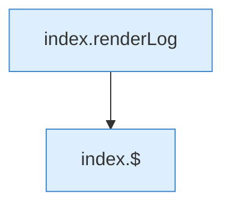

[[00 Start]] › [[Dashboard-UI]] › [[Legacy-Logs]] › [[index.loadLog]] › [[index.loadLog.Teil2]]

# index.loadLog.Teil2



```knoten
index.renderLog
  Die ältere [[Glossar#Bedienseite|Bedienseite]] zeichnet das Protokoll. Zeichnet `renderLog`. Ruft `$`, `cls`.
index.$
  Sucht auf der älteren [[Glossar#Bedienseite|Bedienseite]] ein einzelnes Element. `$` in `index.html`.
```

> [!knoten]- Was die Blöcke tun
> - **index.renderLog**: Die ältere [[Glossar#Bedienseite|Bedienseite]] zeichnet das Protokoll. Zeichnet `renderLog`. Ruft `$`, `cls`.
> - **index.$**: Sucht auf der älteren [[Glossar#Bedienseite|Bedienseite]] ein einzelnes Element. `$` in `index.html`.

- Ein weiterer Abschnitt derselben Übersicht.
- Fortsetzung von `index.loadLog`.
