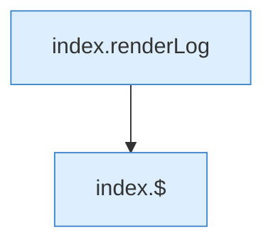

[[00 Start]] › [[Dashboard-UI]] › [[Legacy-Logs]] › [[index.loadLog]] › [[index.loadLog.Teil2]]

# index.loadLog.Teil2



```knoten
index.renderLog
  Zeichnet `renderLog`. Ruft `$`, `cls`.
index.$
  `$` in `index.html`.
```

- Fortsetzung von `index.loadLog`, Quellreihenfolge.
