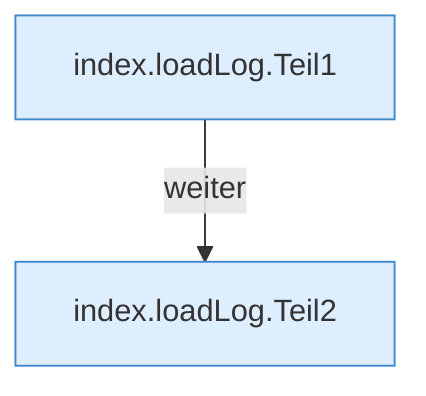

[[00 Start]] › [[Dashboard-UI]] › [[Legacy-Logs]] › [[index.loadLog]]

# index.loadLog

`index.loadLog()` [src/main/resources/web/index.html:152–154](https://github.com/Sciddie/minecraft-serverhoster-plugin/blob/95b02b953b0b4c23673e900e021a7c3c844aa37d/src/main/resources/web/index.html#L152-L154)

- `loadLog` in `src/main/resources/web/index.html`
