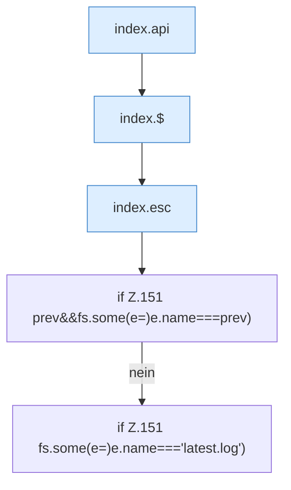

[[00 Start]] › [[Dashboard-UI]] › [[Legacy-Logs]] › [[index.loadLogs]] › [[index.loadLogs.Z150.Teil1]]

# index.loadLogs.Z150.Teil1



```knoten
index.api
  Schickt von der älteren [[Glossar#Bedienseite|Bedienseite]] eine Anfrage an die [[Glossar#Web-Schnittstelle|Web-Schnittstelle]]. Sendet einen Dashboard-Request `api`. Ruft `scoped`, `showLogin`, `toast`.
index.$
  Sucht auf der älteren [[Glossar#Bedienseite|Bedienseite]] ein einzelnes Element. `$` in `index.html`.
index.esc
  Macht einen Text so ungefährlich, dass die Seite ihn anzeigen kann. Maskiert HTML `esc`.
if Z.151 prev&&fs.some(e=)e.name===prev)
  Zeile 151: prüft `prev&&fs.some(e=)e.name===prev)`.
if Z.151 fs.some(e=)e.name==='latest.log')
  Zeile 151: prüft `fs.some(e=)e.name==='latest.log')`.
```

> [!knoten]- Was die Blöcke tun
> - **index.api**: Schickt von der älteren [[Glossar#Bedienseite|Bedienseite]] eine Anfrage an die [[Glossar#Web-Schnittstelle|Web-Schnittstelle]]. Sendet einen Dashboard-Request `api`. Ruft `scoped`, `showLogin`, `toast`.
> - **index.$**: Sucht auf der älteren [[Glossar#Bedienseite|Bedienseite]] ein einzelnes Element. `$` in `index.html`.
> - **index.esc**: Macht einen Text so ungefährlich, dass die Seite ihn anzeigen kann. Maskiert HTML `esc`.
> - **if Z.151 prev&&fs.some(e=)e.name===prev)**: Zeile 151: prüft `prev&&fs.some(e=)e.name===prev)`.
> - **if Z.151 fs.some(e=)e.name==='latest.log')**: Zeile 151: prüft `fs.some(e=)e.name==='latest.log')`.

- Ein weiterer Abschnitt derselben Übersicht.
- Fortsetzung von `index.loadLogs.Z150`.
