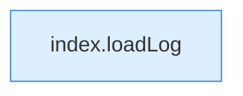

[[00 Start]] › [[Dashboard-UI]] › [[Legacy-Logs]] › [[index.loadLogs]] › [[index.loadLogs.Z150.Teil2]]

# index.loadLogs.Z150.Teil2



```knoten
index.loadLog
  Lädt `loadLog`. Ruft `$`, `api`, `renderLog`.
```

- Fortsetzung von `index.loadLogs.Z150`, Quellreihenfolge.
