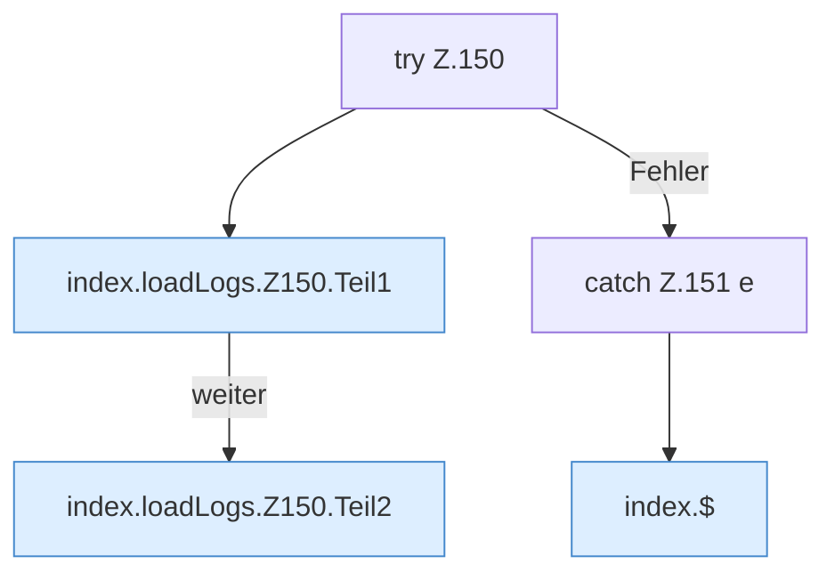

[[00 Start]] › [[Dashboard-UI]] › [[Legacy-Logs]] › [[index.loadLogs]] › [[index.loadLogs.Z150]]

# index.loadLogs.Z150



```knoten
try Z.150
  Zeile 150: Versuch. Der Fehlerpfad geht in catch.
index.loadLogs.Z150.Teil1
  Ein weiterer Abschnitt derselben Übersicht. Abschnitt 1 dieses Ablaufs, in Quellreihenfolge.
index.loadLogs.Z150.Teil2
  Ein weiterer Abschnitt derselben Übersicht. Abschnitt 2 dieses Ablaufs, in Quellreihenfolge.
catch Z.151 e
  Zeile 151: fängt e.
index.$
  Sucht auf der älteren [[Glossar#Bedienseite|Bedienseite]] ein einzelnes Element. `$` in `index.html`.
```

> [!knoten]- Was die Blöcke tun
> - **try Z.150**: Zeile 150: Versuch. Der Fehlerpfad geht in catch.
> - **index.loadLogs.Z150.Teil1**: Ein weiterer Abschnitt derselben Übersicht. Abschnitt 1 dieses Ablaufs, in Quellreihenfolge.
> - **index.loadLogs.Z150.Teil2**: Ein weiterer Abschnitt derselben Übersicht. Abschnitt 2 dieses Ablaufs, in Quellreihenfolge.
> - **catch Z.151 e**: Zeile 151: fängt e.
> - **index.$**: Sucht auf der älteren [[Glossar#Bedienseite|Bedienseite]] ein einzelnes Element. `$` in `index.html`.

- Der Ablauf geht in [[Glossar#Zeile|Zeile]] 150 weiter. Eine Ebene tiefer steht er genauer.
- Fortsetzung von `index.loadLogs`.
