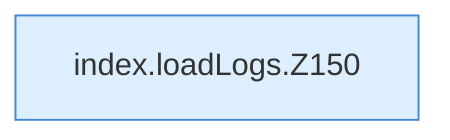

[[00 Start]] › [[Dashboard-UI]] › [[Legacy-Logs]] › [[index.loadLogs]]

# index.loadLogs

`index.loadLogs()` [src/main/resources/web/index.html:150–151](https://github.com/Sciddie/minecraft-serverhoster-plugin/blob/95b02b953b0b4c23673e900e021a7c3c844aa37d/src/main/resources/web/index.html#L150-L151)



```knoten
index.loadLogs.Z150
  Fortsetzung des Ablaufs ab Zeile 150.
```

- `loadLogs` in `src/main/resources/web/index.html`
