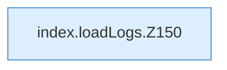

[[00 Start]] › [[Dashboard-UI]] › [[Legacy-Logs]] › [[index.loadLogs]]

# index.loadLogs

`index.loadLogs()` [src/main/resources/web/index.html:150–151](https://github.com/Sciddie/minecraft-serverhoster-plugin/blob/95b02b953b0b4c23673e900e021a7c3c844aa37d/src/main/resources/web/index.html#L150-L151)



```knoten
index.loadLogs.Z150
  Der Ablauf geht in [[Glossar#Zeile|Zeile]] 150 weiter. Eine Ebene tiefer steht er genauer. Im [[Glossar#Quelltext|Quelltext]] heißt das `Z150`.
```

> [!knoten]- Was die Blöcke tun
> - **index.loadLogs.Z150**: Der Ablauf geht in [[Glossar#Zeile|Zeile]] 150 weiter. Eine Ebene tiefer steht er genauer. Im [[Glossar#Quelltext|Quelltext]] heißt das `Z150`.

- Die ältere [[Glossar#Bedienseite|Bedienseite]] lädt die Protokolle.
