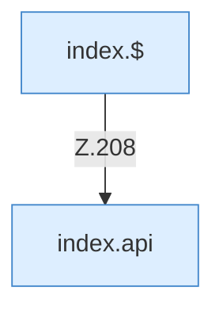

[[00 Start]] › [[Dashboard-UI]] › [[Legacy-Diag]] › [[index.loadPlan]]

# index.loadPlan

`index.loadPlan()` [src/main/resources/web/index.html:208–208](https://github.com/Sciddie/minecraft-serverhoster-plugin/blob/95b02b953b0b4c23673e900e021a7c3c844aa37d/src/main/resources/web/index.html#L208-L208)

- `loadPlan` in `src/main/resources/web/index.html`
