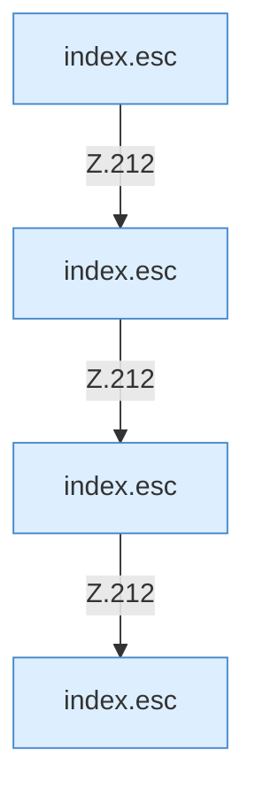

[[00 Start]] › [[Dashboard-UI]] › [[Legacy-Altlast]] › [[index.loadTasks]] › [[index.loadTasks.Calls212.2]]

# index.loadTasks.Calls212.2



```knoten
index.esc
  Macht einen Text so ungefährlich, dass die Seite ihn anzeigen kann. Maskiert HTML `esc`.
```

> [!knoten]- Was die Blöcke tun
> - **index.esc**: Macht einen Text so ungefährlich, dass die Seite ihn anzeigen kann. Maskiert HTML `esc`.

- Ein [[Glossar#Kapitel|Kapitel]] in dieser Übersicht.
- Fortsetzung von `index.loadTasks`.
